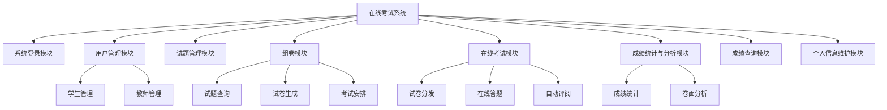
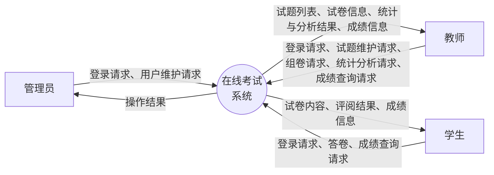
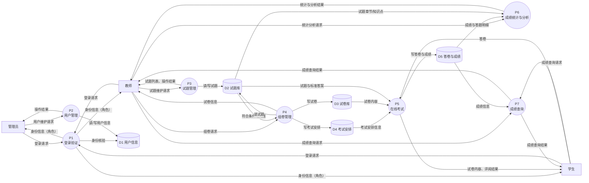
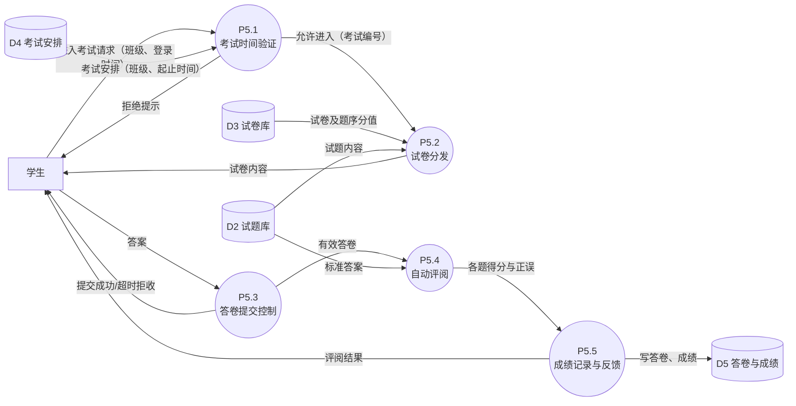

# 《数据库原理实践》课程设计——需求分析

## 在线考试系统

> 本文件对应课程设计报告第（二）章"需求分析"。
> 图采用 Mermaid 绘制（初稿），定稿时可按课程建议用 MS Visio 重绘后插入报告。
> 图、表编号与报告正文连续（本章从图 1、表 1 开始）。

---

## 2.1 系统概述

### 2.1.1 项目背景

传统的考试方式存在若干弊病：手工判卷工作效率低；教师需要按照一定的比例从各章选取不同难度的试题形成一份考试卷，出题工作量大；不能合理和重复使用试卷中包含的试题；成绩汇总统计工作繁琐等。为了提高考试的可靠性、降低考试成本、提高工作效率，需要开发在线考试系统，帮助教师合理管理试题、辅助出题，为学生提供在线考试功能，进行自动阅卷，并提供成绩查询和汇总统计的功能。

为了方便计算机判卷，本系统中的试题采用客观题形式，包括**选择题**和**填空题**两种题型。

### 2.1.2 系统目标

1. 为管理员提供学生信息、教师信息的统一维护入口；
2. 为教师提供试题库维护、组卷、考试安排、成绩统计与卷面分析等功能；
3. 为学生提供在线考试（限时答卷、自动评阅）与成绩查询功能；
4. 基于角色的访问控制保证系统信息安全。

### 2.1.3 用户角色与权限

系统设置三类角色：**管理员、教师、学生**。不同角色登录后进入不同页面，对应不同的系统功能：

| 角色 | 可用功能 |
| --- | --- |
| 管理员 | 系统登录、学生管理、教师管理、个人密码维护 |
| 教师 | 系统登录、试题管理、组卷、成绩统计、卷面分析、成绩查询、个人信息维护 |
| 学生 | 系统登录、在线考试、成绩查询、个人信息维护 |

**信息安全性要求：**

1. 学生信息（学号、专业、班级、姓名、用户名、登录密码等）和教师信息（工号、教授课程、姓名、用户名、登录密码等）的维护只能由管理员进行；其他用户只能维护自己的用户名和登录密码，其他信息只具有查询功能；
2. 题库信息只能由授课教师维护，其他人都不具有维护和查看的权限；
3. 组卷和试卷查询只能提供给教师使用。

---

## 2.2 系统功能模块图

系统功能模块图如图 1 所示。

**图 1 系统功能模块图**

如图 1 所示，系统按功能自顶向下划分为 8 个一级功能模块，其中用户管理模块、组卷模块、在线考试模块、成绩统计与分析模块进一步划分为若干子模块。各模块的功能详细描述如下。

### 2.2.1 系统登录模块

验证登录用户的身份：用户输入用户名和密码后，系统将其与用户表中存储的信息比对；验证通过后根据用户身份（管理员/教师/学生）进入不同的页面，验证失败则给出提示并允许重新输入。该模块是系统所有其他模块的入口，并负责在会话中维护用户身份，防止未登录用户通过 URL 非法访问系统页面。

### 2.2.2 用户管理模块

供**管理员**使用，分为两个子模块：

- **学生管理**：维护学生的基本信息（学号、姓名、性别、专业、班级、用户名、登录密码等），包括学生信息的录入、查询、修改和删除；
- **教师管理**：维护教师的基本信息（工号、姓名、教授课程、用户名、登录密码等），包括教师信息的录入、查询、修改和删除。

学生信息和教师信息的维护权限仅属于管理员，其他角色的用户对这些信息只具有查询功能。

### 2.2.3 试题管理模块

供**教师**使用，用于维护试题库。试题分选择题和填空题两种题型，每道试题记录所属课程、章节、知识点、题干、选项（选择题）、正确答案、难度系数等信息。教师可对本人所授课程的试题进行添加、修改、删除和查询；查询支持按课程、章节、知识点、题型、难度等条件组合进行，并支持对题干内容的模糊查询（例如查询题干中包含"数据库"的所有试题）。题库信息只能由授课教师维护，其他用户（包括管理员）均不能维护和查看。

### 2.2.4 组卷模块

供**教师**使用，分为三个子模块：

- **试题查询**：为方便教师组卷，提供方便的查询功能，使教师能按课程、章节、知识点、题型、难度等不同要求查询试题；
- **试卷生成**：教师根据考试科目，从题库中选择一些符合条件的试题形成一份试卷，并为每道试题设定分值，系统计算试卷总分；试卷生成后可查询、预览和调整；
- **考试安排**：教师为试卷指定应考班级、考试开始时间和结束时间、考试时长等信息，形成考试安排。

组卷和试卷查询功能只能提供给教师使用。

### 2.2.5 在线考试模块

供**学生**使用，分为三个子模块：

- **试卷分发**：根据学生的班级和登录时间，显示其应考科目的试卷内容（仅当当前时间处于该班某场考试的时间窗口内时才允许进入答卷）；
- **在线答题**：学生在考试页面中作答，页面显示剩余时间；试卷完成提交或考试时间到，系统不再允许学生答卷；
- **自动评阅**：学生提交答卷（或考试时间到系统自动收卷）后，系统对照标准答案自动评阅，记录学生的考试成绩，并将评阅结果（得分及各题正误情况）提供给学生。

### 2.2.6 成绩统计与分析模块

供**教师**使用，分为两个子模块：

- **成绩统计**：按照科目、班级等统计学生的考试成绩，包括各班的平均分、最高分、最低分、及格率、优秀率以及分数段分布等；
- **卷面分析**：按照章节、知识点等统计学生对知识点的掌握情况（如各章节的得分率、各知识点的错误率），为教师调整教学重点提供依据。

### 2.2.7 成绩查询模块

供**教师和学生**使用，提供不同查询方式：学生可以查询本人各次考试的成绩及评阅详情；教师可以按科目、班级、学生等条件查询学生的考试成绩，支持按学生姓名的模糊查询（例如查询所有"王"姓学生的成绩）。

### 2.2.8 个人信息维护模块

供**所有角色**使用。用户登录后可以维护自己的用户名和登录密码；除用户名和密码外的其他个人信息（如学号、姓名、班级等）只能查询，不能修改。

---

## 2.3 数据流图

数据流图（DFD）自顶向下逐层分解：顶层数据流图描述系统与外部实体之间的数据交换；0 层数据流图将系统分解为若干主要加工及数据存储；对其中较复杂的"在线考试"加工进一步分解得到 1 层数据流图。

图中符号约定：矩形表示外部实体，圆形表示加工（处理过程），圆柱形表示数据存储，带箭头的连线表示数据流，连线上标注数据流名称。

### 2.3.1 顶层数据流图

顶层数据流图如图 2 所示。

**图 2 顶层数据流图**

如图 2 所示，系统与三个外部实体交互：管理员向系统提交用户维护请求，系统返回操作结果；教师向系统提交试题维护、组卷、统计分析和查询请求，系统返回试题列表、试卷信息、统计结果和成绩信息；学生向系统提交答卷和查询请求，系统返回试卷内容、评阅结果和成绩信息。三类用户均需先向系统提交登录请求并通过身份验证。

### 2.3.2 0 层数据流图

0 层数据流图如图 3 所示。

**图 3 0 层数据流图**

如图 3 所示，系统分解为 7 个主要加工和 5 个数据存储。加工 P1（登录验证）读取数据存储 D1（用户信息）核验用户身份，并把角色信息返回给用户；加工 P2（用户管理）供管理员维护 D1 中的学生和教师信息；加工 P3（试题管理）供教师维护 D2（试题库）；加工 P4（组卷管理）读取 D2 中符合条件的试题，生成试卷写入 D3（试卷库），并将考试安排写入 D4；加工 P5（在线考试）读取 D4、D3、D2 向学生分发试卷，接收答卷并自动评阅，结果写入 D5（答卷与成绩）；加工 P6（成绩统计与分析）读取 D5 并结合 D2 中试题的章节、知识点属性，向教师输出统计与分析结果；加工 P7（成绩查询）读取 D5 向教师和学生提供成绩查询服务。

### 2.3.3 在线考试加工分解数据流图（1 层）

对 0 层数据流图中的加工 P5（在线考试）进一步分解，如图 4 所示。

**图 4 在线考试加工分解数据流图**

如图 4 所示，加工 P5 分解为 5 个子加工：P5.1 根据学生的班级和当前登录时间读取 D4 中的考试安排，验证是否存在该班正在进行的考试，若不在考试时间窗口内则拒绝进入；P5.2 从 D3 读取试卷结构（试题题序及分值）、从 D2 读取试题内容，组成试卷分发给学生；P5.3 接收学生答案，试卷提交或考试时间到后不再接收答卷，仅将有效答卷交给 P5.4；P5.4 读取 D2 中的标准答案逐题比对评分；P5.5 将答卷明细与成绩写入 D5，并把评阅结果反馈给学生。

---

## 2.4 数据字典

### 2.4.1 数据项

系统主要数据项的定义如表 1 所示。

**表 1 数据项表**

| 数据项名 | 别名 | 简述 | 类型及长度 | 取值范围 |
| --- | --- | --- | --- | --- |
| 学号 | student_id | 学生的唯一标识 | CHAR(12) | 12 位数字 |
| 学生姓名 | student_name | 学生姓名 | VARCHAR(30) | — |
| 性别 | gender | 学生性别 | CHAR(2) | {男, 女} |
| 专业 | major | 学生所属专业 | VARCHAR(30) | — |
| 班级 | class | 学生所属班级 | VARCHAR(30) | — |
| 用户名 | username | 登录用用户名 | VARCHAR(30) | 唯一 |
| 登录密码 | password | 登录用密码 | VARCHAR(64) | 存储散列值 |
| 工号 | teacher_id | 教师的唯一标识 | CHAR(8) | 8 位数字 |
| 教师姓名 | teacher_name | 教师姓名 | VARCHAR(30) | — |
| 课程号 | course_id | 课程的唯一标识 | CHAR(8) | — |
| 课程名 | course_name | 课程名称 | VARCHAR(50) | — |
| 试题号 | question_id | 试题的唯一标识 | INT | 自增正整数 |
| 题型 | question_type | 试题类型 | CHAR(4) | {选择, 填空} |
| 章节 | chapter | 试题所属章节 | VARCHAR(30) | — |
| 知识点 | knowledge_point | 试题考查的知识点 | VARCHAR(50) | — |
| 难度系数 | difficulty | 试题难度 | INT | 1~5（1 最易，5 最难） |
| 题干 | content | 试题题目内容 | VARCHAR(500) | — |
| 选项 | options | 选择题的备选项 A~D | VARCHAR(400) | 仅选择题使用 |
| 正确答案 | answer | 试题标准答案 | VARCHAR(200) | — |
| 试卷号 | paper_id | 试卷的唯一标识 | INT | 自增正整数 |
| 试卷名称 | paper_name | 试卷的名称 | VARCHAR(50) | — |
| 总分 | total_score | 试卷卷面总分 | INT | 各题分值之和 |
| 考试时长 | duration | 本场考试的时长 | INT | 分钟，>0 |
| 分值 | score | 某题在试卷中的分值 | INT | >0 |
| 考试编号 | exam_id | 一场考试安排的唯一标识 | INT | 自增正整数 |
| 开始时间 | start_time | 考试开始时间 | DATETIME | — |
| 结束时间 | end_time | 考试结束时间 | DATETIME | 晚于开始时间 |
| 答卷编号 | submission_id | 一份答卷的唯一标识 | INT | 自增正整数 |
| 学生答案 | student_answer | 学生作答内容 | VARCHAR(200) | — |
| 得分 | score_obtained | 学生某题/整卷实际得分 | INT | ≥0 |
| 提交时间 | submit_time | 答卷提交时间 | DATETIME | — |

### 2.4.2 数据结构

系统主要数据结构的定义如表 2 所示。

**表 2 数据结构表**

| 数据结构名 | 简述 | 组成 |
| --- | --- | --- |
| 学生 | 学生的基本信息 | 学号 + 姓名 + 性别 + 专业 + 班级 + 用户名 + 登录密码 |
| 教师 | 教师的基本信息 | 工号 + 姓名 + 教授课程 + 用户名 + 登录密码 |
| 管理员 | 系统管理员的基本信息 | 管理员编号 + 用户名 + 登录密码 |
| 课程 | 考试科目的基本信息 | 课程号 + 课程名 |
| 试题 | 题库中一道试题的信息 | 试题号 + 课程号 + 章节 + 知识点 + 题型 + 题干 + 选项 + 正确答案 + 难度系数 + 录入教师工号 |
| 试卷 | 一份试卷的整体信息 | 试卷号 + 试卷名称 + 课程号 + 总分 + 考试时长 + 组卷教师工号 + 组卷时间 |
| 试卷组成 | 试卷与试题的对应关系 | 试卷号 + 试题号 + 题序 + 分值 |
| 考试安排 | 一场考试的安排信息 | 考试编号 + 试卷号 + 班级 + 开始时间 + 结束时间 |
| 答卷 | 一名学生一次考试的答卷信息 | 答卷编号 + 学号 + 考试编号 + 得分 + 提交时间 |
| 答题明细 | 答卷中每道题的作答与评阅信息 | 答卷编号 + 试题号 + 学生答案 + 实际得分 |

### 2.4.3 数据流

系统主要数据流的定义如表 3 所示。

**表 3 数据流表**

| 数据流名 | 简述 | 来源 | 去向 | 组成 |
| --- | --- | --- | --- | --- |
| 登录请求 | 用户登录时提交的信息 | 管理员/教师/学生 | P1 登录验证 | 用户名 + 登录密码 |
| 身份信息 | 登录验证通过后返回的角色信息 | P1 登录验证 | 管理员/教师/学生 | 角色 + 用户标识 |
| 用户维护请求 | 管理员对学生/教师信息的维护操作 | 管理员 | P2 用户管理 | 操作类型 + {学生 \| 教师} |
| 试题维护请求 | 教师对试题库的维护操作 | 教师 | P3 试题管理 | 操作类型 + 试题 |
| 组卷请求 | 教师选题组卷及安排考试的操作 | 教师 | P4 组卷管理 | 查询条件 + 试卷组成 + 考试安排 |
| 试卷内容 | 分发给学生作答的完整试卷 | P5 在线考试 | 学生 | 试卷 + 试题内容 |
| 答卷 | 学生提交的作答内容 | 学生 | P5 在线考试 | 答卷 + 答题明细 |
| 评阅结果 | 自动评阅后反馈给学生的结果 | P5 在线考试 | 学生 | 得分 + 各题正误 |
| 统计分析请求 | 教师发起的成绩统计/卷面分析请求 | 教师 | P6 成绩统计与分析 | 科目 + 班级 + 统计维度 |
| 统计结果 | 成绩统计与卷面分析的输出 | P6 成绩统计与分析 | 教师 | 平均分 + 及格率 + 分数段分布 + 章节/知识点得分率 |
| 成绩查询请求 | 教师或学生发起的成绩查询 | 教师/学生 | P7 成绩查询 | 查询条件 |
| 成绩信息 | 查询返回的考试成绩 | P7 成绩查询 | 教师/学生 | 学号 + 课程 + 得分 + 提交时间 |

### 2.4.4 数据存储

系统主要数据存储的定义如表 4 所示。

**表 4 数据存储表**

| 数据存储编号 | 数据存储名 | 简述 | 组成 | 相关加工 |
| --- | --- | --- | --- | --- |
| D1 | 用户信息 | 存储学生、教师、管理员的账户与基本信息 | 学生 + 教师 + 管理员 | P1、P2 |
| D2 | 试题库 | 存储全部试题及其章节、知识点、答案属性 | 试题 | P3、P4、P5、P6 |
| D3 | 试卷库 | 存储试卷整体信息及试卷组成 | 试卷 + 试卷组成 | P4、P5 |
| D4 | 考试安排 | 存储各场考试的试卷、班级与起止时间 | 考试安排 | P4、P5 |
| D5 | 答卷与成绩 | 存储学生答卷、答题明细与考试成绩 | 答卷 + 答题明细 | P5、P6、P7 |

### 2.4.5 处理过程

系统主要处理过程的定义如表 5 所示。

**表 5 处理过程表**

| 加工编号 | 加工名 | 输入 | 输出 | 加工逻辑说明 |
| --- | --- | --- | --- | --- |
| P1 | 登录验证 | 登录请求 | 身份信息（角色） | 根据用户名在 D1 中检索对应账户，比对密码；若一致则返回用户角色并建立会话，否则返回失败提示 |
| P2 | 用户管理 | 用户维护请求 | 操作结果 | 仅管理员可用；对学生/教师信息进行增、删、改、查，写入 D1 |
| P3 | 试题管理 | 试题维护请求 | 试题列表、操作结果 | 仅授课教师可用；按课程维护试题，支持按章节/知识点/题型/难度组合查询及题干模糊查询，写入 D2 |
| P4 | 组卷管理 | 组卷请求 | 试卷信息 | 仅教师可用；按条件从 D2 选题并设定分值生成试卷写入 D3，安排考试班级与起止时间写入 D4 |
| P5 | 在线考试 | 答卷、进入考试请求 | 试卷内容、评阅结果 | 见 1 层分解（图 4）：验证考试时间与班级 → 分发试卷 → 限时收卷 → 自动评阅 → 成绩写入 D5 |
| P6 | 成绩统计与分析 | 统计分析请求 | 统计结果 | 仅教师可用；从 D5 汇总成绩，按科目/班级统计平均分、及格率、分数段分布，结合 D2 的章节/知识点属性计算得分率 |
| P7 | 成绩查询 | 成绩查询请求 | 成绩信息 | 学生仅可查询本人成绩；教师可按科目/班级/姓名（模糊）查询学生成绩 |

---

## 2.5 非功能性需求

1. **安全性**：口令以散列形式存储；按角色实施访问控制（管理员/教师/学生三类），满足 2.1.3 节的信息安全要求；防止未登录用户通过 URL 直接访问系统页面。
2. **并发性**：考试期间同一班级学生同时在线答卷，系统应支持并发读写，答卷提交需保证完整性（借助数据库事务）。
3. **可靠性**：考试时间到系统自动收卷，已作答内容不得丢失；自动评阅结果须准确、可复查（保留答题明细）。
4. **易用性**：界面简洁友好，教师组卷时提供方便的试题查询功能。
